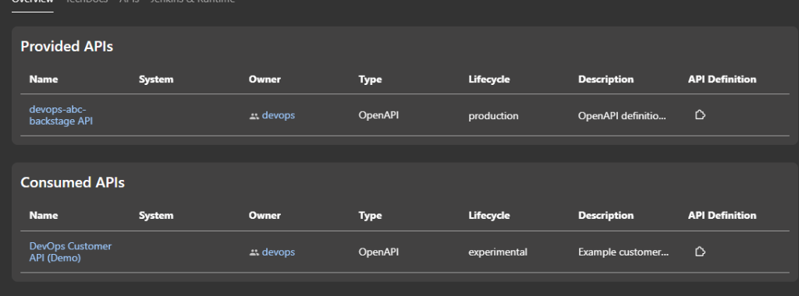
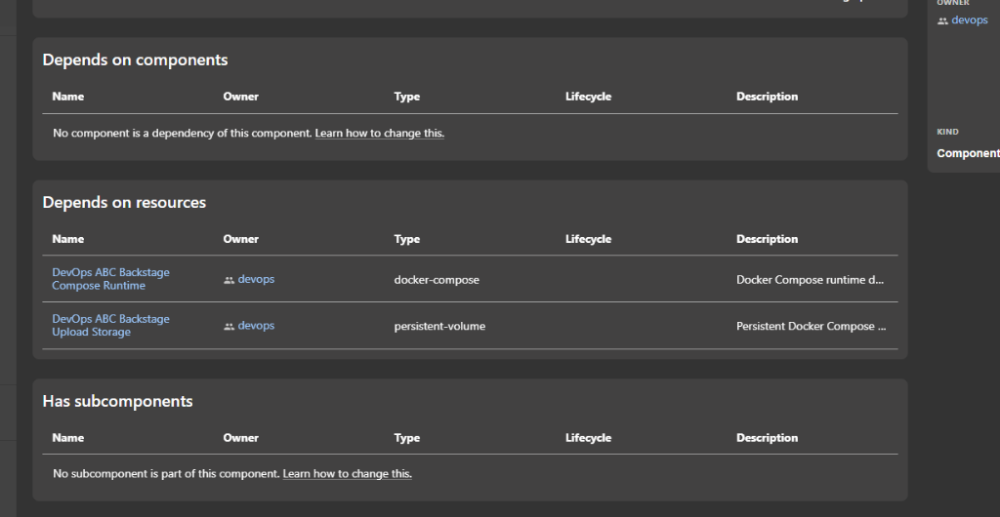
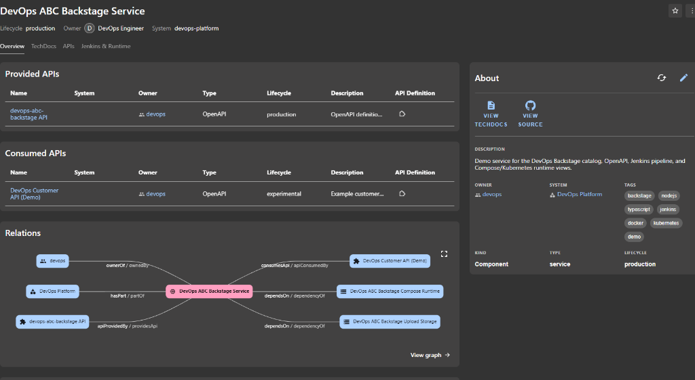

# Backstage Catalog & TechDocs Guide

This guide explains how to configure `catalog-info.yaml`, author and link TechDocs documentation, manage Provided and Consumed APIs, and declare component dependencies and subcomponents.

---

## 1. Documentation & TechDocs

### Where to Write Documentation
In Backstage, documentation follows the **Docs-like-Code** paradigm using [TechDocs](https://backstage.io/docs/features/techdocs/). All technical documentation resides directly within the code repository:

```
├── docs/
│   ├── assets/
│   │   └── images/               # Store diagrams and screenshots here
│   │       ├── backstage-service-overview.png
│   │       ├── backstage-apis-provided-consumed.png
│   │       └── backstage-dependencies-subcomponents.png
│   ├── index.md                  # Homepage of your documentation
│   ├── catalog.md                # This guide
│   ├── architecture.md           # System design & flow
│   ├── development.md            # Local setup & configuration
│   ├── api.md                    # API details
│   ├── deployment.md             # Docker & deployment guides
│   └── troubleshooting.md        # Common issues & fixes
├── mkdocs.yml                    # TechDocs navigation & metadata
└── catalog-info.yaml             # Backstage Catalog descriptor
```

### Linking Documentation in Backstage
To tell Backstage that this repository has TechDocs, add the `backstage.io/techdocs-ref` annotation to `catalog-info.yaml`:

```yaml
metadata:
  annotations:
    # Tells Backstage to read mkdocs.yml and the docs/ directory from repository root
    backstage.io/techdocs-ref: dir:.
```

### Configuring Navigation in `mkdocs.yml`
Open `mkdocs.yml` to define how pages appear in the Backstage TechDocs sidebar navigation:

```yaml
site_name: "abc-observability"
site_description: "abc-observability"
docs_dir: docs
nav:
  - Overview: index.md
  - Backstage Catalog Guide: catalog.md
  - Architecture: architecture.md
  - Development: development.md
  - API Reference: api.md
  - Deployment: deployment.md
  - Troubleshooting: troubleshooting.md
plugins:
  - techdocs-core
```

### How to Link Documents and Embed Images
* **Internal Markdown Links**: Use relative paths between files, for example `[Architecture](architecture.md)` or `[API Reference](api.md#endpoints)`.
* **Embedding Images**: Place images into `docs/assets/images/` and reference them using relative paths:
  ```markdown
  
  ```
* **External Links Card**: In `catalog-info.yaml`, add links under `metadata.links` to display quick links on the Overview page:
  ```yaml
  metadata:
    links:
      - url: https://github.com/my-org/my-repo
        title: Source Code
        icon: github
      - url: https://grafana.example.com
        title: Metrics & Monitoring
        icon: dashboard
  ```

---

## 2. API Configuration: Provided vs Consumed ("Customer") APIs

Backstage organizes APIs into two categories on the Component Overview page:
1. **Provided APIs**: APIs implemented, published, and served by your service.
2. **Consumed APIs**: APIs published by other services that your service calls (often referred to as client or customer APIs).



### Setting Up Provided APIs (Provider)

1. In `catalog-info.yaml`, register the API under `spec.providesApis`:
   ```yaml
   spec:
     providesApis:
       - devops-abc-backstage-api
   ```
2. In the same file (separated by `---`) or in a dedicated catalog file, declare the `kind: API` entity:
   ```yaml
   apiVersion: backstage.io/v1alpha1
   kind: API
   metadata:
     name: devops-abc-backstage-api
     title: devops-abc-backstage API
     description: OpenAPI definition for devops-abc-backstage service.
     tags:
       - rest
       - openapi
   spec:
     type: openapi
     lifecycle: production
     owner: devops
     system: devops-platform
     definition:
       $text: ./src/swagger.json
   ```
   * **Definition `$text`**: Backstage reads the OpenAPI schema directly from `src/swagger.json`. Whenever you rebuild and push the swagger file, Backstage updates its API documentation viewer.

### Setting Up Consumed APIs (Customer / Upstream APIs)

When your service interacts with external or upstream services (e.g., calling customer APIs, billing APIs, or auth services):

1. In `catalog-info.yaml`, add the API reference under `spec.consumesApis`:
   ```yaml
   spec:
     consumesApis:
       - devops-customer-api
   ```
2. The referenced API can either be an existing API entity in the Backstage catalog or declared as an example:
   ```yaml
   apiVersion: backstage.io/v1alpha1
   kind: API
   metadata:
     name: devops-customer-api
     title: DevOps Customer API (Demo)
     description: Example customer API consumed by this service.
     tags:
       - rest
       - openapi
       - customer
   spec:
     type: openapi
     lifecycle: experimental
     owner: devops
     system: devops-platform
     definition: |
       openapi: 3.0.0
       info:
         title: DevOps Customer API (Demo)
         version: 1.0.0
       paths:
         /customers:
           get:
             summary: List customers
             responses:
               '200':
                 description: OK
   ```
   * **Result**: Backstage displays the API in the **Consumed APIs** table and renders an active `consumesApi / apiConsumedBy` relationship in the Relations graph.

---

## 3. Dependencies & Subcomponents

The bottom section of the Component page tracks component dependencies, external infrastructure resources, and component hierarchies.



### Depends on Components & Resources (`spec.dependsOn`)

The `spec.dependsOn` field takes a list of entity references. Backstage separates them into **Depends on components** and **Depends on resources** based on their entity kind:

```yaml
spec:
  dependsOn:
    # 1. Component Dependency (Service-to-Service):
    # Appears under "Depends on components"
    - component:default/auth-service

    # 2. Resource Dependencies (Infrastructure, Runtimes, Volumes, DBs):
    # Appears under "Depends on resources"
    - resource:default/devops-abc-backstage-compose-runtime
    - resource:default/devops-abc-backstage-upload-storage
```

#### Defining Resources (`kind: Resource`)
Resources represent infrastructure components such as databases, message queues, Docker Compose environments, or persistent storage volumes:

```yaml
---
apiVersion: backstage.io/v1alpha1
kind: Resource
metadata:
  name: devops-abc-backstage-compose-runtime
  title: DevOps ABC Backstage Compose Runtime
  description: Docker Compose runtime deployment target.
spec:
  type: docker-compose
  owner: devops
  system: devops-platform
---
apiVersion: backstage.io/v1alpha1
kind: Resource
metadata:
  name: devops-abc-backstage-upload-storage
  title: DevOps ABC Backstage Upload Storage
  description: Persistent Docker Compose volume for uploaded assets.
spec:
  type: persistent-volume
  owner: devops
  system: devops-platform
```

### Subcomponents (`spec.subcomponentOf` and `spec.subcomponents`)

Backstage allows decomposing complex services into parent-child subcomponents:

* **Child Component**: Declare which parent it belongs to:
  ```yaml
  spec:
    subcomponentOf: component:default/parent-service
  ```
* **Parent Component**: List child subcomponents:
  ```yaml
  spec:
    subcomponents:
      - component:default/worker-task-queue
      - component:default/notification-gateway
  ```
* If no subcomponents are defined, Backstage displays:
  > *"No subcomponent is part of this component. Learn how to change this."*

---

## 4. Systems, Owners & The Relations Graph



Backstage automatically computes the Relations Graph from the metadata fields you define:

| YAML Configuration | Backstage Graph Edge | Description |
| --- | --- | --- |
| `spec.owner: devops` | `ownerOf` / `ownedBy` | Links team to the component |
| `spec.system: devops-platform` | `hasPart` / `partOf` | Links component to its parent system |
| `spec.providesApis: [...]` | `apiProvidedBy` / `providesApi` | Exposes service API contract |
| `spec.consumesApis: [...]` | `consumesApi` / `apiConsumedBy` | Connects service to upstream client APIs |
| `spec.dependsOn: ['resource:...']` | `dependsOn` / `dependencyOf` | Tracks runtime & storage dependencies |
| `spec.dependsOn: ['component:...']` | `dependsOn` / `dependencyOf` | Tracks inter-service dependencies |

---

## 5. Complete Reference `catalog-info.yaml`

Below is the standard, production-ready `catalog-info.yaml` structure:

```yaml
apiVersion: backstage.io/v1alpha1
kind: Component
metadata:
  name: "abc-observability"
  title: "abc-observability"
  description: "abc-observability"
  tags:
    - backstage
    - nodejs
    - typescript
    - service
  annotations:
    backstage.io/techdocs-ref: dir:.
    github.com/project-slug: 
    jenkins.io/job-full-name: 
    company.io/runtime: 
    company.io/deployment-binding: 
    company.io/deployment-signature: 
    backstage.io/kubernetes-id: "abc-observability"
    backstage.io/kubernetes-namespace: 
  links:
    - url: https://github.com/
      title: Source Code
      icon: github
spec:
  type: service
  lifecycle: production
  owner: 
  system: devops-platform

  # 1. Provided APIs
  providesApis:
    - abc-observability-api

  # 2. Consumed APIs ("Customer API")
  consumesApis:
    - devops-customer-api

  # 3. Dependencies
  dependsOn:
    - resource:default/abc-observability-compose-runtime
    - resource:default/abc-observability-upload-storage

  # 4. Subcomponents (optional)
  # subcomponents: []
---
apiVersion: backstage.io/v1alpha1
kind: API
metadata:
  name: abc-observability-api
  title: abc-observability API
  description: OpenAPI definition for abc-observability.
  tags:
    - rest
    - openapi
spec:
  type: openapi
  lifecycle: production
  owner: 
  system: devops-platform
  definition:
    $text: ./src/swagger.json
```
